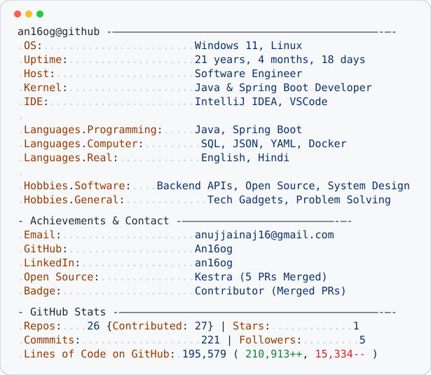

  <a href="https://github.com/An16og/An16og">
    <picture>
      <source media="(prefers-color-scheme: dark)" srcset="https://raw.githubusercontent.com/An16og/An16og/main/dark_mode.svg">
      
    </picture>
  </a>

    

  ### 🌟 Open Source Contributions

  

